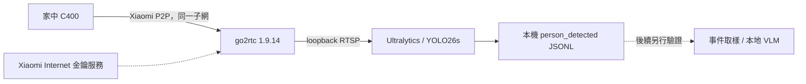

# Local Camera Lab

把家中的 Xiaomi C400 串流接到本地 YOLO26，產生可檢查的人物觀測事件；保存串流、模型與 framework 的完整來源筆記，供後續實驗重用。

**狀態：POC 程式與研究文件；家庭 C400、CUDA 推論與即時效能尚未驗證。**
本輪只準備並發布 repo，不登入攝影機、不下載模型、不執行 GPU 或家庭影像測試。
程式檢查結果見 [驗證紀錄](docs/verification.zh-TW.md)。



攝影機、go2rtc 與 GPU 主機在家中同一子網測試。連上 Xiaomi 帳號不代表外地主機能直接讀取影像；go2rtc 的 Xiaomi source 仍需要 Internet 取得連線金鑰。[官方說明](https://github.com/AlexxIT/go2rtc/blob/v1.9.14/internal/xiaomi/README.md)

## 文件入口

- [C400／go2rtc 完整筆記與回家操作手冊](docs/c400-go2rtc.zh-TW.md)：型號、協定、MIoT、登入、網路、解碼、音訊、替代方案。
- [模型與 framework 研究筆記](docs/models-frameworks.zh-TW.md)：全部候選模型、授權、runtime、benchmark 與階段性接入方式。
- [原文來源與完整性](docs/sources/README.md)：使用者提供全文、SHA-256、引用占位符及章節對照。
- [回家驗收與目前驗證](docs/verification.zh-TW.md)：把自動檢查、真實串流與效能測量分開。

## 固定基線

| 元件 | 選定值 | 證據狀態 |
| --- | --- | --- |
| go2rtc | 1.9.14，Linux amd64 官方 binary | [已發布](https://github.com/AlexxIT/go2rtc/releases/tag/v1.9.14)；未執行 |
| Python | 3.12 | CLI／標準函式庫測試環境 |
| Ultralytics | 8.4.170 | [已發布](https://github.com/ultralytics/ultralytics/releases/tag/v8.4.170)；未安裝 |
| Detector | `yolo26s.pt`，person，640，FP32，NMS-free | [官方模型](https://docs.ultralytics.com/models/yolo26)；未下載／推論 |
| GPU runtime | torch 2.14.1／torchvision 0.29.1，cu130 | [官方版本配對](https://github.com/pytorch/vision/releases/tag/v0.29.1)；本機相容性待驗證 |

這是候選環境的固定直接依賴，不是已經完成安裝的完整 lockfile。回家完成環境驗證後，將實際 `pip freeze`、driver、CUDA、權重 hash 與測試輸出留在 `.local/`。不修改其他專案的環境。

## 回家後準備與啟動

以下命令供回家測試時手動執行。Linux amd64／Ubuntu 與 NVIDIA GPU 為此操作路線；先確認實際主機與 C400 同一子網、驅動符合 CUDA 13.x，並有可用 GPU 資源。CUDA 13.x 的最低驅動系列為 580；版本門檻不替代推論測試。[NVIDIA 相容性](https://docs.nvidia.com/deploy/cuda-compatibility/minor-version-compatibility.html)

### 1. go2rtc 與私人設定

```bash
umask 077
mkdir -p .local/bin .local/models
curl --fail --location \
  https://github.com/AlexxIT/go2rtc/releases/download/v1.9.14/go2rtc_linux_amd64 \
  --output .local/bin/go2rtc
printf '%s  %s\n' \
  32d616af226bd731678ffde328b94cfb94e30339bfefc469cfb76323144615a6 \
  .local/bin/go2rtc | sha256sum --check
```

只有 SHA-256 通過才繼續：

```bash
chmod 700 .local/bin/go2rtc
# 只在第一次建立設定；不覆寫已登入的設定。
test -e .local/go2rtc.yaml || cp config/go2rtc.example.yaml .local/go2rtc.yaml
chmod 600 .local/go2rtc.yaml
.local/bin/go2rtc -c .local/go2rtc.yaml
```

在該主機的瀏覽器開啟 `http://127.0.0.1:1984`，使用 Add → Xiaomi，由本人輸入帳號、密碼及驗證碼。選擇真正看得到攝影機的帳號區域，將 stream 命名為 `c400`。不要把 Xiaomi 設定、token 或含私人資訊的畫面貼到公開 issue。區域代碼、畫質及解碼檢查見 [攝影機手冊](docs/c400-go2rtc.zh-TW.md)。

此設定只啟用 API、RTSP、Xiaomi；loopback API 供本機 onboarding 使用。沒有公開網路 port forwarding，也沒有啟用 WebRTC。若主機沒有桌面，可用 SSH 本機轉發管理頁，步驟見攝影機手冊。

### 2. 獨立 Python 環境與權重

```bash
python3.12 -m venv .venv
source .venv/bin/activate
python3 -m pip install -r requirements-gpu.txt
python3 -m pip install -r requirements.txt
curl --fail --location \
  https://github.com/ultralytics/assets/releases/download/v8.4.0/yolo26s.pt \
  --output .local/models/yolo26s.pt
printf '%s  %s\n' \
  646f8bc3fe0a656803d95c294f7852321748cb29d13466a1af8862e2db384a1b \
  .local/models/yolo26s.pt | sha256sum --check
```

權重 digest 來自 [官方 assets release](https://github.com/ultralytics/assets/releases/tag/v8.4.0)，2026-10-01 查核；digest 不符即停止並重新查核來源，不略過檢查。模型需由官方來源取得；程式要求已存在的模型檔，避免啟動時隱藏下載。

### 3. 人物事件 POC

```bash
python3 detect.py \
  --source rtsp://127.0.0.1:8554/c400 \
  --model .local/models/yolo26s.pt \
  --device 0 \
  --camera c400 \
  --confidence 0.5 \
  --cooldown-seconds 30 \
  --output .local/events.jsonl
```

也接受 `--source .local/test.mp4`；CPU 路線使用 `--device cpu`，不代表有即時效能。CLI 只接受 loopback RTSP 或本機檔案，上游攝影機的位址／憑證留在 go2rtc。Ctrl-C 停止；每筆事件都 flush，既有輸出以 append 保留。

程式使用 `stream=True`、`stream_buffer=False`，推論較慢時由 Ultralytics 保留較新的畫面；攝影機 FPS、推論 FPS 與觀測延遲仍需分開量測。[Predict API](https://docs.ultralytics.com/modes/predict)

## 事件介面與已知邊界

以下完全是合成範例，並非家庭實測：

```json
{
  "schema_version": 1,
  "observed_at": "2026-10-01T00:00:00+00:00",
  "camera": "example_camera",
  "event": "person_detected",
  "model": "yolo26s.pt",
  "person_count": 1,
  "image_size": {"width": 2560, "height": 1440},
  "detections": [
    {"label": "person", "confidence": 0.9, "bbox_xyxy": [1, 2, 100, 200]}
  ]
}
```

- `observed_at` 是程式整理該結果的 UTC 時間，並非 sensor timestamp；bbox 是原始影像像素座標，confidence 是模型分數。
- `person_count` 是這次畫面的偵測框數，並非唯一訪客數。事件只表示看到人物，不推斷進門、離開、身分或行為。
- 第一筆合格偵測立即輸出；此後每個執行程序最多每 30 秒再輸出一次，無人物不輸出。重啟會重設冷卻；它是節流，不是持續 occupancy／跨程序去重。
- 離線影片也使用處理時間冷卻；需要逐結果分析時設 `--cooldown-seconds 0`。離線事件不作影片時間軸 ground truth。
- 使用套件原有 reconnect 行為，live generator 結束或讀取例外以非零碼離開，修復來源後手動重啟；沒有外加 watchdog、bounded-read 保證或 24 小時服務承諾。
- 預設不存圖片、影片或音訊，也沒有 VLM 描述。JSONL 仍可能揭露家中活動時間，保存於忽略的私人 `.local/`。
- 使用合成資料通過測試，不代表 detector accuracy、HEVC 解碼、CUDA 或實機 reconnect 已通過。

## 開發檢查

```bash
python3 -m unittest discover -s tests -v
python3 detect.py --help
python3 -m py_compile detect.py
git diff --check
```

測試僅使用標準函式庫與合成 detection，不安裝 PyTorch、不連線攝影機、不下載權重；GitHub Actions 執行相同檢查。

## 後續實驗與授權

先通過 [回家 gate](docs/verification.zh-TW.md)，再依測量決定是否比較 YOLO26n／YOLOE-26／RF-DETR、加速格式或事件 VLM。詳細候選、授權、benchmark 條件及需要新增的介面見 [模型筆記](docs/models-frameworks.zh-TW.md)。

本 repo 自有程式採 [AGPL-3.0-only](LICENSE)。go2rtc、Ultralytics、各模型權重保留各自授權；公開 repo 不重新授權或再散布它們。第三方比較筆記不表示全部候選都有相同商用權利。
