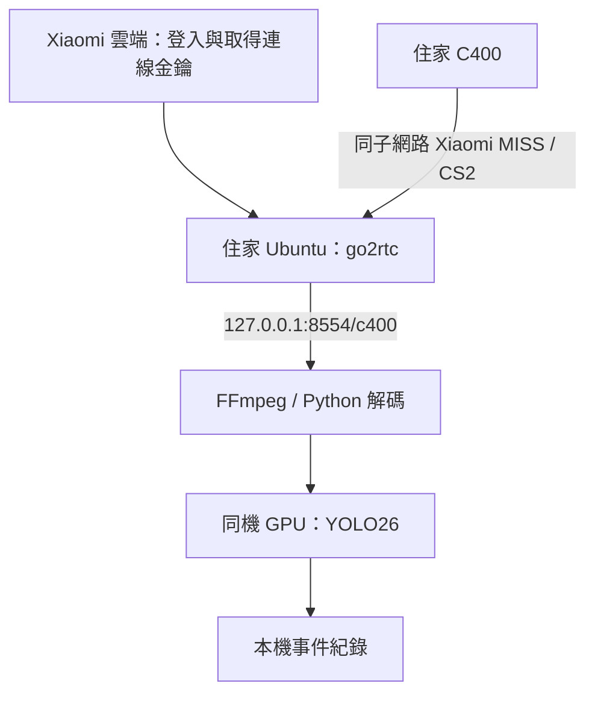

# Xiaomi C400 串流取得與 go2rtc 實驗筆記

來源查核日期：2026-10-01。本文保存攝影機規格、串流協定、可行路線與回家後的操作程序；專案入口見 [README](../README.md)，使用者提供的完整原文見 [來源逐字稿](sources/2026-10-01-user-passage.txt)。原文內的 `chatgpt-content-reference` 標記沒有附上可解析的來源，本文以重新查核的連結建立證據。

目前採用 **C400 → 同一住家子網路的 go2rtc → 本機 RTSP → 同機 GPU / YOLO26**。使用者會將 go2rtc 與 GPU 主機移回家，再測試實際攝影機。現階段完成研究與設定準備；攝影機登入、串流解碼、GPU 推論與長時間穩定度均待實機驗證。

## 1. 硬體規格與相容性證據

| 項目 | 已查核資料 | 實機驗證邊界 |
| --- | --- | --- |
| 台灣販售型號 | 小米台灣規格頁列 `MJSXJ23CM`，並註明初版為 `MJSXJ11XM` | 商品名稱不足以辨識使用者現有硬體版本，先看底部銘牌 |
| 影像與網路 | 規格頁列 2560×1440、2.4 / 5 GHz Wi-Fi | 實際串流解析度、幀率及碼率依設定與韌體量測 |
| 視訊編碼 | 台灣官網連結的多語手冊列 MJSXJ23CM、H.265 | 尚未從使用者的攝影機取得 codec；手冊文字已查核，PDF 畫面擷取逾時 |
| C400 internal model | go2rtc 維護者相容性清單同時列 `chuangmi.camera.039a04`（2022）與 `chuangmi.camera.039c04`（2024），協定均為 CS2 | 這是成功回報彙整；仍需記錄實機 internal model、韌體與測試結果 |
| MJSXJ23CM 與 039c04 對應 | 2025-01-08 的使用者問題回報同時列出兩者 | 支持該使用者裝置的對應，不能直接套用到所有台灣 C400 |

來源：[小米台灣規格](https://www.mi.com/tw/product/xiaomi-smart-camera-c400/specs/)、[官方手冊 PDF](https://user-guide2024.cnbj1.mi-fds.com/user-guide2024/Taiwan/S1/Xiaomi%20Smart%20Camera%20C400%20User%20Manual.pdf)、[go2rtc 已知 Xiaomi 攝影機](https://github.com/AlexxIT/go2rtc/issues/1982)、[MJSXJ23CM / 039c04 第一手回報](https://github.com/al-one/hass-xiaomi-miot/issues/2291)。

原文所述「039c04 是 ECN 海外版」可追到社群 MIoT 產品目錄，但本次未找到小米第一方出版資料直接確認該硬體沿革，因此保留為待查資訊。選擇測試路線時以實機識別與串流結果為準，不以型號後綴推定性能或穩定度。

## 2. 協定、帳號與 MIoT 介面的分工

在本次查閱的小米官方產品頁與手冊中，未找到 C400 對一般使用者公開的原生 RTSP URL 或 ONVIF 支援聲明。小米官方 `xiaomi_home` 專案另有明確限制：其攝影機串流採 P2P 加密，該 Home Assistant integration 無法協商需要的影像金鑰，因此不提供攝影機即時影像。這個限制描述的是官方 integration 的能力。[官方限制說明](https://github.com/XiaoMi/ha_xiaomi_home/wiki/Features-that-will-not-be-implemented)

go2rtc 實作 Xiaomi 串流來源，透過帳號取得連線授權，再與攝影機建立影像連線。其文件描述 2020 年後逐漸採用的 `miss` 協定；程式碼使用 `xiaomi/miss` 與 `xiaomi/legacy` 路徑，並處理 CS2 與 TUTK 傳輸。現行 README 的格式名稱有 `xiaomi/mess` 字樣，本文依程式碼使用 `miss`，不將拼字差異解讀成另一種協定。[Xiaomi 模組文件](https://github.com/AlexxIT/go2rtc/blob/master/internal/xiaomi/README.md)、[來源路由程式碼](https://github.com/AlexxIT/go2rtc/blob/v1.9.14/pkg/xiaomi/producer.go)



go2rtc 文件要求**每次建立攝影機連線時能連上 Internet 取得金鑰**，攝影機影像連線則限定本地網路。這使影像處理可以在家中主機執行，但啟動與重新連線仍有 Xiaomi 帳號及雲端依賴。go2rtc 對影像連線的描述，也不足以證明攝影機本身沒有其他 Xiaomi 雲端通訊。[Xiaomi 模組文件](https://github.com/AlexxIT/go2rtc/blob/master/internal/xiaomi/README.md)

### MIoT schema 能證明什麼

已直接讀取 MIoT instance JSON，兩個 C400 internal model 都有串流相關服務，但 service ID 與欄位組成不同：

| internal model | `p2p-stream` | Google Home 串流服務 | Alexa 串流服務 |
| --- | --- | --- | --- |
| `chuangmi.camera.039a04` | service 6；`start-p2p-stream`、`stop-stream` | service 9；`start-hls-stream`、`stop-stream`、`get-stream-configuration` | service 10；`start-rtsp-stream`、`stop-stream`、`get-stream-configuration` |
| `chuangmi.camera.039c04` | service 9；上述 P2P 動作及 `upload-video`，另有影音 codec、取樣率、通道等屬性 | service 18；Google Home 串流動作與參數 | service 19；Alexa 串流動作與參數，另列 session / WebRTC 欄位 |

Google Home 服務中的 `stream-address`、`stream-auth-token`、`expiration-time`，證明 schema 定義了串流地址、授權與有效期。`start-rtsp-stream` 出現在 Alexa 服務中，不能據此推定攝影機提供固定、公開的 LAN RTSP server。Schema 也不能替代帳號、地區、韌體與實際呼叫成功的證據。這個專案由 go2rtc 處理協定與帳號流程，不自行硬編碼 MIoT service ID。

原始資料：[039a04 instance JSON](https://miot-spec.org/miot-spec-v2/instance?type=urn%3Amiot-spec-v2%3Adevice%3Acamera%3A0000A01C%3Achuangmi-039a04%3A1)、[039c04 instance JSON](https://miot-spec.org/miot-spec-v2/instance?type=urn%3Amiot-spec-v2%3Adevice%3Acamera%3A0000A01C%3Achuangmi-039c04%3A1%3A0000D02E)。

### 同子網路要求

維護者在 2026-02-05 的問題討論要求 Xiaomi 攝影機與 go2rtc 位於同一子網路，並指出容器網路需讓攝影機協定的連入封包可達；同一討論有 OpenVPN 跨子網路逾時回報。因此第一輪採 Ubuntu 原生 binary，排除 Docker bridge / NAT 的額外變數。[上游問題 #2074](https://github.com/AlexxIT/go2rtc/issues/2074)

v1.9.14 的 CS2 程式會向指定攝影機 IP 的 UDP 32108 傳送單播 LAN-search 封包，等待同一 IP 從動態連接埠回覆，再以 UDP 或協商出的 TCP 連接埠繼續。即使要求 `transport=tcp`，初始發現仍包含 UDP。`32108` 因而不是整條影像連線唯一使用的連接埠；HTTP / RTSP 綁定 loopback 也不會取消 Xiaomi 來源所需的 LAN socket。[CS2 程式碼](https://github.com/AlexxIT/go2rtc/blob/v1.9.14/pkg/xiaomi/miss/cs2/conn.go)

未來若再次採遠端 GPU，可以先評估「家中 go2rtc → 私有 VPN 內的 RTSP/TCP → 遠端推論」。直接讓遠端 go2rtc 經 Tailscale subnet router 連 C400，目前僅列為待驗證替代方案：Tailscale 提供第三層路由與預設 SNAT，無法單憑 IP 可達就確認 Xiaomi 動態連接埠與攝影機韌體接受該拓樸。L2 tunnel 也需要實測。本輪不建立 VPN、變更路由或公開攝影機連接埠。[Tailscale subnet router 說明](https://tailscale.com/docs/features/subnet-routers)

## 3. 版本與解碼風險

截至來源查核日，go2rtc 最新正式 release 為 **v1.9.14（2026-01-19）**。Xiaomi source 自 v1.9.13 加入；v1.9.14 改善 CS2 UDP/TCP、TCP keepalive、captcha 登入、部分音訊取樣率及雙向音訊等。基準實驗固定 v1.9.14，未來若需測 master，另記 commit 與結果，保留可還原的已知設定。[正式 release](https://github.com/AlexxIT/go2rtc/releases/tag/v1.9.14)

原文引用的 C400 HEVC 問題 #2030 是 **039a04 使用 v1.9.13** 的第一手回報，包含卡頓、參考影格錯誤與 NALU 錯誤。該 issue 已關閉，milestone 為 v1.9.14；維護者回覆 CS2 UDP 已改善，也解釋串流未從 keyframe 開始時可出現初始 HEVC 錯誤。這些紀錄支持升級基準版本與觀察啟動恢復，但不構成所有 HEVC 問題都已解決的保證。[問題 #2030 與維護者回覆](https://github.com/AlexxIT/go2rtc/issues/2030)

回家測試須分開記錄：

- 首個可解碼影格前的等待與錯誤；是否在 keyframe 到達後恢復。
- 進入穩定串流後是否持續出現損毀、停止更新、重複畫面或延遲增長。
- RTSP 解碼是否成功，以及瀏覽器能否播放同一 codec；兩者是不同檢查。

同一 issue 後續有其他 Xiaomi 機型的 FFmpeg 轉碼經驗，不能直接當作 C400 修復方式。先保存本機 FFmpeg 解碼證據，再決定是否需要調畫質、傳輸方式或轉碼；不以更換 C400 revision 作為預設解法。

## 4. 回家後的最小操作程序

本節命令是待執行 runbook。執行位置為 repo 根目錄；本次研究沒有下載 binary、登入帳號或啟動串流。

### 4.1 確認環境並取得固定版本

將 Ubuntu / GPU 主機接到 C400 所在的住家子網路，確認相同 SSID 並不必然代表相同子網路，來賓 Wi-Fi 或 AP client isolation 仍可能阻擋裝置互通。記錄攝影機銘牌、Mi Home 顯示的韌體與地區，以及主機 OS / CPU 架構。以裝置設定或路由器管理介面確認攝影機地址，不做全面網段掃描。

```bash
uname -m
command -v ffprobe
command -v ffmpeg
```

以下下載範例適用 **Ubuntu x86_64 / amd64**。其他架構需從相同 release 選對應檔案及該檔案的 SHA-256；不要沿用 amd64 雜湊值。先確認 `.local/` 已被 Git 忽略。

```bash
umask 077
mkdir -p .local/bin
curl --fail --location \
  --output .local/bin/go2rtc \
  https://github.com/AlexxIT/go2rtc/releases/download/v1.9.14/go2rtc_linux_amd64
printf '%s  %s\n' \
  '32d616af226bd731678ffde328b94cfb94e30339bfefc469cfb76323144615a6' \
  '.local/bin/go2rtc' | sha256sum --check -
```

SHA-256 必須通過才繼續。下載來源與雜湊值均來自 [v1.9.14 release assets](https://github.com/AlexxIT/go2rtc/releases/tag/v1.9.14)。雜湊核對可確認下載內容與 release 所列值一致；它不額外提供獨立的發布者簽章驗證。

```bash
chmod 700 .local/bin/go2rtc
.local/bin/go2rtc -v
```

### 4.2 建立私有設定並前景啟動

首次建立 `.local/go2rtc.yaml` 時填入以下內容。若檔案已存在，先檢查並保留原有帳號及串流設定，不覆寫既有內容。

```yaml
app:
  modules: [api, rtsp, xiaomi]

api:
  listen: "127.0.0.1:1984"

rtsp:
  listen: "127.0.0.1:8554"

streams: {}
```

```bash
chmod 600 .local/go2rtc.yaml
.local/bin/go2rtc -c .local/go2rtc.yaml
```

此設定保留 Xiaomi 登入 UI 與 RTSP 功能，HTTP API 和 RTSP 僅接受本機連線。module allowlist 排除 WebRTC 與 `exec` / `echo` 等額外來源；實際 WebRTC、HLS 或 FFmpeg module 需要時再加入。**不要把 `webrtc.listen: ""` 當成完全關閉 WebRTC**：該實作在未指定固定地址時仍可使用動態 UDP socket。[模組初始化](https://github.com/AlexxIT/go2rtc/blob/v1.9.14/main.go)、[WebRTC socket 行為](https://github.com/AlexxIT/go2rtc/blob/v1.9.14/pkg/webrtc/api.go)、[API 安全設定](https://github.com/AlexxIT/go2rtc/blob/master/internal/api/README.md)

這是單一受信任本機使用者的起點。若主機有其他不受信任的使用者或程序，需設定 API / RTSP 認證；API 的 `local_auth: true` 必須搭配 username / password。API 能管理來源與讀取設定，不應對公開網路暴露。不要增加 `origin: "*"`，也不要把本機服務透過無認證 proxy 對外開放。[安全說明](https://github.com/AlexxIT/go2rtc#security)

### 4.3 Xiaomi 登入、地區與 camera identity

1. 在該主機瀏覽器開啟 `http://127.0.0.1:1984/`，選 **Add → Xiaomi**。
2. 由使用者直接輸入 Xiaomi 帳號、密碼，完成需要的 email / phone 驗證碼或 captcha。密碼與驗證碼不貼進聊天、issue、README 或 shell history。
3. 選帳號及對應地區後載入裝置。v1.9.14 UI 提供 `cn`、`de`、`i2`、`ru`、`sg`、`us`；沒有 `tw`。以實際 Mi Home 帳號設定與能列出本人攝影機的結果確認，不直接推定台灣等於 `sg`。
4. 核對裝置名稱、IP 與 internal model，將攝影機加入為 `c400`。URL 由 UI 產生，保留實際帳號 ID、region、DID、model 與 IP；不要從範例猜出這些值。
5. 登入後帳號 token 會寫回 YAML，重新確認檔案權限為 600。設定、token、DID、裝置地址與原始診斷輸出都留在 `.local/`。公開筆記只保留匿名裝置代號、型號、版本與彙總結果。

登入流程見 [Xiaomi 模組文件](https://github.com/AlexxIT/go2rtc/blob/master/internal/xiaomi/README.md)；地區選項見 [v1.9.14 Add UI](https://github.com/AlexxIT/go2rtc/blob/v1.9.14/www/add.html)；token 持久化與帳號查詢見 [Xiaomi integration 程式碼](https://github.com/AlexxIT/go2rtc/blob/v1.9.14/internal/xiaomi/xiaomi.go)。

```bash
stat -c '%a %n' .local/go2rtc.yaml
```

若 UI 列不出本人裝置，先確認帳號、地區、共享裝置權限與 Internet 連線，保存去識別後的錯誤分類。登入成功、列出裝置、取得金鑰與成功解碼，各自需要證據。

若家中主機沒有桌面，可從自己可連到該主機的電腦，用 SSH 轉發管理頁。下列 `USER@HOME_HOST` 由本人替換；不另外建立對外 port forwarding。這只轉發管理頁，攝影機與 go2rtc 仍須同子網。

```bash
ssh -N -L 127.0.0.1:1984:127.0.0.1:1984 USER@HOME_HOST
```

在發起 SSH 的電腦開啟 `http://127.0.0.1:1984/`；該電腦的 port 1984 必須未被其他服務占用。

### 4.4 畫質與 RTSP 解碼

go2rtc 的 Xiaomi source 可接受 `subtype=hd/sd/auto/0-5`。v1.9.14 中 C400 的預設 HD 路徑為數值 2，SD 為 1，auto 為 0；部分其他機型有數值 3 的特例。先測預設值，只有在卡頓或頻寬不足時增加 `&subtype=sd` 做對照。不要把其他機型的 `subtype=3` / `5` 經驗，或 MIoT schema 的 resolution enum，直接當成 C400 實際畫質映射。[畫質文件](https://github.com/AlexxIT/go2rtc/blob/master/internal/xiaomi/README.md)、[v1.9.14 畫質映射](https://github.com/AlexxIT/go2rtc/blob/v1.9.14/pkg/xiaomi/miss/client.go)

先以本機 RTSP 檢視串流 metadata；外層 `timeout` 避免串流未建立時無限等待：

```bash
timeout 30s ffprobe -v error -rtsp_transport tcp \
  -show_entries stream=index,codec_type,codec_name,width,height,r_frame_rate,avg_frame_rate,sample_rate,channels \
  -of json 'rtsp://127.0.0.1:8554/c400'
```

`r_frame_rate` / `avg_frame_rate` 是串流 metadata，可能缺值、為 `0/0`，或不同於實際收到的影格速率；它們不能單獨證明 30 FPS。接著做 60 秒視訊解碼煙霧測試，丟棄解碼輸出、不保存居家畫面：

```bash
timeout 90s ffmpeg -hide_banner -loglevel warning -stats \
  -rtsp_transport tcp -i 'rtsp://127.0.0.1:8554/c400' \
  -map 0:v:0 -an -t 60 -f null -
```

`timeout` 結束碼 124 表示超時，不能記為成功；有 metadata 也不等於成功解碼。先完成一次 smoke test，再以 10 分鐘連續觀察與三次關閉 / 重新開啟 consumer 檢查建立連線的穩定性。這些長度與次數是本專案首輪驗證預算，並非上游產品保證。若首次連線錯誤在 keyframe 後恢復，記錄恢復時間；若穩定階段仍持續出錯，保留版本與症狀，停止上疊 AI pipeline。

FFmpeg / ffprobe 參數依 [FFmpeg protocol 文件](https://ffmpeg.org/ffmpeg-protocols.html#rtsp) 與 [ffprobe 文件](https://ffmpeg.org/ffprobe.html) 使用；RTSP-over-TCP 只控制 consumer 與 go2rtc 之間的傳輸，並不自動將 Xiaomi CS2 來源改為 TCP。

## 5. 音訊、瀏覽器與替代方案

go2rtc Xiaomi source 支援雙向音訊，C400 039a04 的第一手串流回報包含 H.265 與 OPUS/48000/2。然而音訊接收、音訊解碼、瀏覽器麥克風權限及傳回攝影機喇叭，是四個不同驗證項目。首輪只做影像；ASR、錄音與 two-way audio 待選定情境後再測，避免將居家音訊無意加入資料集。[Xiaomi source](https://github.com/AlexxIT/go2rtc/blob/master/internal/xiaomi/README.md)、[C400 音訊回報](https://github.com/AlexxIT/go2rtc/issues/2030)

RTSP、WebRTC、MSE 與 HLS 是不同輸出路徑。H.265 能否在瀏覽器播放，取決於瀏覽器版本、OS、硬體解碼與所選輸出格式；go2rtc 支援輸出不等於任何瀏覽器都能播放。保留原始 H.265 供本機解碼；如果之後的瀏覽器需求確實不支援，再為該輸出增加 FFmpeg H.264 轉碼並量測 CPU / GPU 成本。首輪 allowlist 沒有啟用 browser video modules，因此不能用瀏覽器播放失敗否定 RTSP baseline。[go2rtc codec 說明](https://github.com/AlexxIT/go2rtc#codecs)

| 替代路線 | 用途與採用條件 |
| --- | --- |
| `hass-xiaomi-miot` | 可研究控制項或整合既有 HA；039c04 曾回報不支援 play stream service，schema 內的 Google Home HLS 動作不保證實際可用。先以日期、版本與裝置條件描述問題，不推定永久失效。 |
| 官方 `xiaomi_home` | 適用官方支援的裝置控制；其設計限制目前排除 camera live stream。 |
| Frigate | 當需求擴展至錄影、事件檢索或 NVR 時，再評估消費 go2rtc RTSP 的方式；不是取得第一張影格的前置條件。 |
| 其他 go2rtc build / 社群修補 | 正式版存在可重現缺陷時才建立獨立比較，固定 commit 並保留原 baseline。 |
| 原生 RTSP / ONVIF 攝影機、USB camera | 未來更換 sensor 時保留相同解碼與推論入口；是否支援與品質仍依具體型號驗證。 |

HA 證據：[社群 integration 的 C400 回報](https://github.com/al-one/hass-xiaomi-miot/issues/2291)、[官方 integration 的限制](https://github.com/XiaoMi/ha_xiaomi_home/wiki/Features-that-will-not-be-implemented)。Frigate 入口：[go2rtc restream 文件](https://docs.frigate.video/configuration/restream/)。

## 6. 首輪結果與下一個 gate

目前所有實機欄位均為 **待測**。回家後由 Jason 核對銘牌、Mi Home 帳號地區及測試權限；執行者保存下列結果：

| 紀錄 | 保存位置與完成條件 |
| --- | --- |
| 實機 identity | 私有紀錄保留型號、韌體、地區、IP / DID；公開結果只放必要且去識別的型號與版本 |
| 串流建立 | 記錄 go2rtc 版本、Xiaomi 傳輸方式、設定畫質及第一次可解碼影格時間 |
| 解碼結果 | codec、解析度、metadata 幀率、測試區間、收到的影格與持續錯誤；成功不能只靠 ffprobe 有輸出 |
| 連續 / 重連 | 完成 60 秒解碼、10 分鐘觀察與三次重連；保存中斷、恢復時間及結果 |
| 證據 custody | `.local/` 保存原始設定與診斷；tracked docs 僅放去識別結論與本機證據 locator |
| 後續工作 | RTSP 可穩定解碼後，才開始 YOLO26 人物偵測；音訊、WebRTC、VLM、錄影及 24 小時測試各自保留獨立驗收 |

go2rtc 在上游已有可用路線與 C400 成功回報；本專案的下一個 gate 是使用者返家後取得自己這台 C400 的可重現 RTSP 解碼證據。
