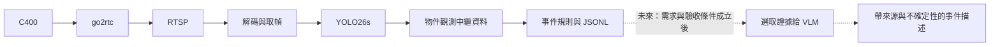

# 即時影像辨識：模型、框架與比較方法

查核日期：2026-10-01（Asia/Taipei）。讀者是維護此家庭攝影機實驗的使用者與開發者。專案入口見 [README](../README.md)；使用者提供的完整構想保留於[原始段落](sources/2026-10-01-user-passage.txt)，其中的 ChatGPT reference index 並非可追溯網址。本筆記以模型維護者、正式文件、版本公告與授權檔補足來源。

第一版採 **go2rtc → RTSP → YOLO26s → person detection 中繼資料**。串流接入、解碼、偵測、事件規則與 VLM 描述分別驗證。使用者日後會在家中同一子網測試；2026-10-01 的交付範圍是文件、程式與公開 repo，尚未連接 C400、安裝 GPU 套件、下載權重或取得實測結果。

## 第一版的固定選擇

| 項目 | 固定值／目前狀態 |
| --- | --- |
| 模型與框架 | `yolo26s.pt`、`ultralytics==8.4.170`；checkpoint 是 COCO detection 模型 |
| 推論條件 | FP32：`quantize=32`；`nms=False`；`classes=[0]`；`imgsz=640` |
| 串流行為 | `stream=True`；`stream_buffer=False`；逐筆消費結果，允許捨棄舊幀 |
| 第一版輸出 | person detection／事件中繼資料；原始影像、音訊、事件片段及 VLM 描述不在第一版保存範圍 |
| 第一版語意 | `person_detected` 表示偵測到人；沒有進出線／ROI 規則時不標示 `person_entered` |
| GPU 候選環境 | Python 3.12、`torch==2.14.1`、`torchvision==0.29.1`、官方 cu130 wheel；尚未在目標機驗證 |
| 可重現性 | 日後實跑時記錄 checkpoint SHA256、完整依賴、driver、GPU、模型與推論參數；目前不填造 hashes 或測量值 |

YOLO26 在 2026 年 1 月發布，已有 detection 權重；Ultralytics 8.4.170 的發布日期為 2026-09-30。本專案保留此版本作初始比較基線，升版需另記結果。[YOLO26 文件][yolo26]、[8.4.170 release][ultralytics-release]

RTSP 可直接傳入 Ultralytics。`stream=True` 控制結果以 generator 回傳；`stream_buffer=False` 控制新幀到達時捨棄待處理舊幀。兩者用途不同，也不保證攝影機、網路或 decoder 內沒有其他緩衝。現行文件用 `quantize` 表達精度，`half` 已 deprecated；`nms=False` 選擇可用的 NMS-free head。[Predict API][predict]

第一版保留 Ultralytics 原有讀取路徑，先確認 H.265 可正常解碼。只在時間戳、重新連線或解碼控制形成具體需求時增加 PyAV；模型 API 能接受 RTSP 並不代表目標主機的 codec 與攝影機串流已通過測試。

## 原始段落的能力與主張校正

1. **COCO 80 類沒有 `package` 或 `box`。** `person`、`backpack`、`cat`、`dog` 是可用類別；包裹需自訂訓練、open-vocabulary 模型或另外驗證的語意判讀。不能讓預訓練 YOLO26 的示例輸出預設包含包裹。[官方類別表][coco-classes]
2. **偵測到人和進入房間是不同結果。** 後者需要事先定義區域、方向、時間與去重條件。第一版僅承諾偵測；ID 也只代表本次追蹤，不代表真實身分。
3. **YOLO26 的七種任務使用不同權重。** `yolo26s.pt` 做 detection；instance segmentation、semantic segmentation、depth、classification、pose、OBB 各有對應 checkpoint，不會由單一 detection 權重同時輸出。[任務表][yolo26]
4. **模型名稱不是完整 runtime 設定。** 權重版本、NMS head、precision、輸入大小、decoder、抽幀、tracker 及輸出處理都會改變結果，必須一起保存。
5. **官方 benchmark 支持其指定環境中的比較。** T4／H100、batch 16 的數值不等於 RTX 5080、單一路家庭串流的 FPS 或延遲。第一版也不假定 C400 提供 30 FPS；實際 FPS 留待串流量測。
6. **VLM 的描述是模型推論。** 偵測、追蹤、時間規則與敘述各保留來源。`A person entered carrying a box` 不能由單張 person bbox 升格而來。
7. **9B total／2B active 的 MoE 仍需處理總權重容量。** active 參數主要描述每 token 運算量；不能依 2B 估算全部 VRAM。9B × 2 bytes 約 18 GB 只是 BF16 權重粗估，還未加 activation、KV cache 與 runtime。

## 模型比較與測試順序

以下「已發布」表示維護者提供相應文件／權重，與本機可執行及家庭畫面驗收分開記錄。優先順序依本專案需求排列，不是跨任務總排名。

| 模型／checkpoint | 已確認用途與發布狀態 | 授權來源與邊界 | 本專案下一個適用情境 |
| --- | --- | --- | --- |
| **YOLO26s** `yolo26s.pt` | 已發布；固定類別 detection，其他任務另選權重 | Ultralytics AGPL-3.0／Enterprise；程式與模型均需依實際取得方式保留授權資訊 | 第一版 person 偵測基線；吞吐或功耗不足時比較 `yolo26n.pt`。[模型][yolo26] |
| **YOLOE-26** `yoloe-26s-seg.pt` | 已發布；文字／visual exemplar 的開放類別偵測與 instance segmentation；prompt-free 另用 `*-seg-pf.pt` | Ultralytics AGPL-3.0／Enterprise；不能因匯出格式改變而忽略來源授權 | 需要包裹、自訂物件類別時，先測少量具體名詞提示。[文件][yoloe] |
| **RF-DETR** | 已發布；detection、segmentation，keypoints 目前為 preview；ICLR 2026 | 核心 code、N–L detection 與目前表列 segmentation 權重為 Apache-2.0；**XL／2XL detection** 要 `rfdetr_plus`，適用 PML 1.0 | YOLO 基線穩定後，以相同家庭畫面測另一 detector。[repo][rfdetr]、[Plus license][rfdetr-plus] |
| **SAM 3.1** `facebook/sam3.1` | 2026-03-27 發布；概念分割、影片物件追蹤與 Object Multiplex | 自訂 SAM License；下載權重依 HF 授權流程，不能概括成 Apache | 需要精細 mask／密集追蹤時，測事件片段。[公告][sam-announcement]、[release][sam-release]、[license][sam-license] |
| **Qwen3-VL-4B-Instruct** `Qwen/Qwen3-VL-4B-Instruct` | 4B／8B 在 2025-10-15 發布；影像、多影像與影片語意理解 | 此 checkpoint 為 Apache-2.0 | 當物件／事件中繼資料不足以回答問題時，作事件描述比較基線。[repo][qwen-repo]、[model card][qwen-card] |
| **MiniCPM-V 4.6** `openbmb/MiniCPM-V-4.6` | 2026-05-11 發布，約 1.3B；影像／影片理解，4×／16×視覺 token 壓縮 | 此版 model card 為 Apache-2.0 | 需要較小 VLM 時優先比較；小參數量本身不保證家中事件判讀正確。[release history][minicpm-repo]、[model card][minicpm-v] |
| **MiniCPM-o 4.5** `openbmb/MiniCPM-o-4_5` | 2026-02-03 發布，9B；full-duplex 影音輸入與文字／語音輸出 | 此版權重與 code 標示 Apache-2.0 | 確有聲音與同步影音需求後另開測試；第一版不啟用。[history][minicpm-repo]、[model card][minicpm-o] |
| **Moondream 3.1** `moondream/moondream3.1-9B-A2B` | 2026-07-07 發布；9B total／2B active；query、caption、detect、point；Photon 文件亦提供 segment | **Moondream Model License 1.0**；與 3-preview 的 BSL 及舊程式 repo 的 Apache 標示分開 | 需要專門視覺 API 時比較，先處理目標 GPU 的記憶體與 runtime 驗證。[release][moondream-release]、[card][moondream-card]、[Photon][photon] |
| **YOLO27／YOLOE-27** | 2026-09-13 公布；查核日尚無公開權重、設定檔或實作，沒有確定上線日期 | 發布時再查實際 artifact 授權 | 保留候選紀錄；目前不能用 preview 範例取代 YOLO26。[公告][yolo27-announcement]、[狀態][yolo27] |

RF-DETR 的授權依模型變體區分，原文「RF-DETR → Apache 2.0」需補上這個條件。Moondream 3.1 的 license 允許多種研究與產品用途，並對 hosted model service 設有特定限制；產品化前應讀當次 checkpoint 的完整條文。這些資訊用於選型與保存來源，不構成對尚未定義產品的法律結論。[RF-DETR 授權表][rfdetr]、[PML 1.0][rfdetr-plus]、[Moondream Model License 1.0][moondream-license]

### Detector 與追蹤的額外成本

YOLO26 的 COCO 官方結果可用來建立模型大小的候選順序，但 NMS 與 end-to-end 結果應分欄比較。官方表列 YOLO26s 為 48.6 mAP、end-to-end 47.8 mAP；其 T4 TensorRT latency 2.5 ms 屬該 benchmark 環境，不是本 repo 的 FP32 RTSP 實測。[COCO benchmark][coco-benchmark]

YOLOE-26 需要 Ultralytics ≥8.4.0。文字提示首次呼叫會準備 CLIP 與約 254 MB 的 text encoder；部署前應將額外下載與依賴納入清單。prompt-free 的 4,585-name vocabulary 已確認，但 prompt-free checkpoint 不接受 `set_classes()`。PyTorch 提示可變；匯出 ONNX／TensorRT 後提示類別固定，改類別需重新匯出。複雜關係、顏色與細分類仍需實際資料驗證。[YOLOE requirements／export][yoloe]

第一版不需追蹤才能證明串流 person detection。若下一輪加入追蹤，以 `tracker="bytetrack.yaml"` 作固定視角的簡單基線；當下 Ultralytics 預設為 TrackTrack，依賴預設會讓升版後的比較失去一致性。ByteTrack 沒有 appearance ReID 或 camera-motion compensation；C400 雲台轉動時須另驗證，不直接沿用固定視角的進出區域判斷。[Tracking 文件][track]

SAM 3.1 的官方更新說明，Object Multiplex 可在一次 forward 處理最多 16 個物件；「16→32 FPS」限定單張 H100、影片中等物件數的情境。release note 另報告 128 個物件時約 7× speedup，並呈現不同資料集上的混合變化。它適合進一步處理需要 mask 的片段；單張 5080 能承受多少物件與影片長度尚待測量。[Meta 公告][sam-announcement]、[release note][sam-release]

### VLM 與影音模型的 runtime 條件

- **Qwen3-VL-4B**：官方最低 Transformers 版本為 4.57.0；權重檔總量約 8.89 GB。影像解析度、影片幀數及生成長度會改變記憶體用量，不能用權重檔大小宣告 16 GB 同時承載 detector 與 VLM 必然足夠。[repo][qwen-repo]、[權重清單][qwen-files]
- **MiniCPM-V 4.6**：目前 model card 的原生用法採 Transformers ≥5.7.0；也列有 Ollama、vLLM、SGLang 等路線。官方指出 torchcodec 可能與 CUDA 套件不相容，提供 PyAV 作替代。測試應固定視覺壓縮模式與抽幀上限，避免在不同 token budget 下比較速度。[model card][minicpm-v]
- **MiniCPM-o 4.5**：官方特定測試列 BF16 約 19 GB、INT4 約 11 GB 的 GPU memory usage，不能當作 5080 保證。先核對量化格式、支援 runtime、音訊解碼與影音同步；全雙工能力不會自動替 C400 完成這些接線。[model card][minicpm-o]
- **Moondream 3.1**：Photon 文件列出 `md.photon("moondream3.1-9B-A2B")` 與五種視覺 API。NVIDIA 已明列測試卡含 RTX PRO 6000，沒有 RTX 5080；文件的 Ampere 以上一般相容敘述與特定卡的驗證證據需分開。官方 Moondream 3.1 速度比較用 H100 SXM5、batch 16。[Photon requirements][photon]、[benchmark methodology][moondream-release]

Qwen3-VL 在此是已有正式權重與清楚介面的候選，不代表 2026-10-01 所有 VLM 的最新家族。Photon 文件已列 Qwen3.5、Qwen3.6 與 Gemma 4；是否增列比較，由現有模型的具體失敗或資源瓶頸決定。[Photon model list][photon]

## 框架與資料流的分工



| 工具／框架 | 本專案用途 | 採用條件與完成檢查 |
| --- | --- | --- |
| **go2rtc** | 將 camera-specific ingest 與後續標準 RTSP consumer 分開 | 攝影機相容性及認證驗證由接入文件管理；AI 程式只依賴本地 RTSP 設定 |
| **Ultralytics／PyTorch** | 直接讀 RTSP、執行 YOLO26、取得 bbox／score／class | 第一版採用；檢查真實 decode、推論與中繼資料輸出，不先新增通用 model adapter |
| **FFmpeg／ffprobe** | 查看 codec、stream metadata、診斷解碼 | 日後先查實際輸入與 error，再判斷是否需轉碼；H.265 不因下游叫 RTSP 就變成 H.264。[ffprobe][ffprobe] |
| **OpenCV** | `VideoCapture` 與陣列影像介面；Ultralytics 既有路徑可先沿用 | backend／codec 能力依安裝而異；成功開啟 handle 與持續讀到有效幀分開檢查。[VideoCapture][opencv] |
| **PyAV** | FFmpeg 的 Python binding，可較細緻控制 container、packet、frame | 需要 PTS／time base、取幀策略或重新連線控制時再引入。[PyAV docs][pyav] |
| **ONNX／ONNX Runtime** | 匯出與替換推論 backend 的候選 | PyTorch 基線完成後才比較；驗證前處理、shape、輸出與 NMS/head 一致性。[Ultralytics ONNX][onnx] |
| **TensorRT** | NVIDIA 上的模型最佳化 | 先測 FP16；INT8 另需代表性校正資料與精度檢查。engine 與 build GPU／CUDA／TensorRT 綁定，不能視為一般可攜式權重。[TensorRT][tensorrt] |
| **Frigate** | 需要 NVR、錄影與整合式攝影機事件管理時的候選 | 接受 RTSP 與接受任意 `.pt` 模型是不同條件；須核對 Frigate 版本、detector backend、模型格式、tensor layout 與 label map。[Detectors 文件][frigate] |
| **Transformers／Ollama／vLLM／Photon** | 未來事件 VLM 的模型專用 runtime | 第一版不部署；逐一依 model card 建立獨立環境與驗收，避免所有候選共用一套不相容依賴 |

第一版用 JSONL 足以保存可稽核的結果，不需另外部署 PostgreSQL、message broker 或 agent。若日後需要跨次查詢，先評估標準函式庫 SQLite；只有明確的查詢量、併發或整合需求才增加服務。

物件觀測描述「這一幀的模型輸出」；事件描述「一段時間內符合哪些規則」；VLM interpretation 描述「模型如何理解選取的視覺證據」。未來 schema 應能區分三者的時間、模型、來源與推測，並保留 `unknown`／無法判定。VLM 不直接驅動家庭設備或通知；若日後需要動作，另訂使用者確認與錯誤處理條件。

## GPU 安裝候選與後續驗證

以下命令是供日後目標主機建立獨立環境的文件，不表示已執行。本輪只核對官方 release 與 wheel index；模型 checkpoint 的實際 hash 待下載後填入。

```bash
# 在日後建立的 Python 3.12 專案環境內執行。
python3 -m pip install \
  torch==2.14.1 torchvision==0.29.1 \
  --index-url https://download.pytorch.org/whl/cu130
python3 -m pip install ultralytics==8.4.170
```

TorchVision 0.29.1 公告明確配對 PyTorch 2.14.1；官方 cu130 index 有兩者的 Python 3.12／Linux x86_64 wheels。CUDA 13.x 一般要求 NVIDIA driver 580 系列以上，實跑時仍須核對完整 driver 與 runtime 相容性。此選擇尚未證明與本 repo 及 RTX 5080 的組合運作正常。[TorchVision release][vision-release]、[torch index][torch-index]、[torchvision index][vision-index]、[NVIDIA compatibility][cuda-compat]

若既有 driver 適合 CUDA 12.8，可另建獨立候選環境使用官方明列的配對；不要自動升級 driver、覆寫使用者已有 runtime，或把這組結果混入 cu130 基線：

```bash
# 獨立 cu128 比較環境；不在上面的 cu130 環境混裝。
python3 -m pip install \
  torch==2.11.0 torchvision==0.26.0 \
  --index-url https://download.pytorch.org/whl/cu128
python3 -m pip install ultralytics==8.4.170
```

此替代配對列於[官方版本安裝表][torch-previous]。Blackwell 支援從 PyTorch 2.7／CUDA 12.8 build 開始；CUDA 12.6 wheel 即使能看到 GPU，也不能據此當成 Blackwell 可運算的證據。[PyTorch Blackwell release][torch-blackwell]

日後驗證依序記錄：

1. GPU／driver／OS／Python、`torch.__version__`、`torch.version.cuda`、`torch.cuda.get_arch_list()` 與可用 VRAM。
2. 實際 CUDA tensor 運算，再以固定測試影像執行 YOLO26；`torch.cuda.is_available()` 只是其中一個檢查。
3. 同一子網 C400 → go2rtc → RTSP 的有效幀、codec、解析度、時間資訊與斷線行為。
4. 維持固定 FP32／NMS-free 條件執行串流，核對事件中繼資料、停止行為及資源使用。
5. 再分別評估 FP16、YOLO26n、ONNX 或 TensorRT；一次只改一個主要因素，保留上一組可重現結果。

## 未來比較實驗與接受證據

目前沒有 benchmark 結果。日後先建立輸入串流與事件定義，再比較模型。若需要保存家庭影像供離線重播，先由使用者決定資料範圍、保存位置、期限與可分享內容；第一版的中繼資料輸出不會自動擴張成錄影或音訊採集。公開 repo 只保存設定、方法與去識別化彙整，家庭媒體留在私有保存位置。

| 比較面向 | 控制／記錄方式 | 可支持的結論 |
| --- | --- | --- |
| 共同輸入 | 相同片段、相同標註、相同測試順序或記錄隨機種子；包括空畫面、日夜、遮擋、短暫出現與照明變化 | 模型在本批家庭情境的差異 |
| 偵測品質 | 固定 class map、confidence、IoU 與評分方法；precision、recall、FP／FN；有完整 bbox 標註才報 mAP | 物件辨識與定位品質 |
| 事件品質 | 先定義起訖、觸發、合併、冷卻與正負樣本；event precision／recall、重複事件、每小時誤報 | 指定事件規則的可用性 |
| 時間 | 分開報 decode、preprocess、inference、postprocess、寫入耗時；warmup 與正式測量分開，保留樣本數與 p50／p95 | 已量到的階段與 host 端延遲 |
| frame age | 有可信 capture timestamp 與時鐘對齊才量 capture-to-result；僅有接收時間／PTS 時標示其意義 | 缺少時間戳儀器時記 `unknown`，不得以 inference time 冒充端到端延遲 |
| FPS 與丟幀 | 分開記來源 FPS、decode FPS、processed FPS、drop／skip 計數及觀察區間；無法取得的項目留未知 | 吞吐與即時性的取捨 |
| 資源 | GPU VRAM peak、utilization、CPU、RAM、GPU power 的時間序列與採樣率 | 目標機上的資源成本；GPU power 不等於整機插座功耗 |
| 可靠性 | decode errors、連線次數、重試、恢復時間、連續運行時間；重啟與網路失效另列 | 實際觀察期間的穩定度 |
| VLM 品質 | 同一組證據幀與提示；人工核對物件、動作、先後關係、臆測與無法判定；記錄 token／frames／context | 被抽樣事件的語意描述能力 |

若之後加入 fine-tuning，先依錄影時段／場景或事件群組切開 train／validation／test，防止同一事件的相鄰幀跨 split。confidence、ROI、事件規則及量化校正只用 training／validation 選擇；固定 test 後再報最終結果。保存每個 split 的清單與內容 hash，新增資料時產生新版本，不在同一 test 上反覆挑最佳設定。

第一個人工驗收只需證明：人在指定畫面出現時，系統依既定條件輸出可檢查的 `person_detected` 中繼資料；空畫面與斷流不產生偽造觀測。一次成功不代表 event recall 已達標，也不代表 24 小時穩定；這兩項需要獨立測量。評估長時間運行時，以真實經過時間記錄，不以短測試外推。

VLM 的啟用條件是使用者已提出 detector／事件規則無法回答的具體問題，且已決定允許提供的視覺證據。屆時先比較 MiniCPM-V 4.6 與 Qwen3-VL-4B，固定抽幀與輸出長度，觀察描述是否改善決策及增加多少延遲／VRAM；SAM、Moondream、影音模型依失敗案例加入。YOLO27 只有在正式 artifact 與 runtime 都可取得時才進入相同測試。

[yolo26]: https://docs.ultralytics.com/models/yolo26
[ultralytics-release]: https://github.com/ultralytics/ultralytics/releases/tag/v8.4.170
[predict]: https://docs.ultralytics.com/modes/predict
[coco-classes]: https://docs.ultralytics.com/datasets/detect
[coco-benchmark]: https://docs.ultralytics.com/datasets/detect/coco
[yoloe]: https://docs.ultralytics.com/models/yoloe
[track]: https://docs.ultralytics.com/modes/track
[rfdetr]: https://github.com/roboflow/rf-detr
[rfdetr-plus]: https://github.com/roboflow/rf-detr_plus/blob/main/LICENSE
[sam-announcement]: https://ai.meta.com/blog/segment-anything-model-3/
[sam-release]: https://github.com/facebookresearch/sam3/blob/main/RELEASE_SAM3p1.md
[sam-license]: https://github.com/facebookresearch/sam3/blob/main/LICENSE
[qwen-repo]: https://github.com/QwenLM/Qwen3-VL
[qwen-card]: https://huggingface.co/Qwen/Qwen3-VL-4B-Instruct
[qwen-files]: https://huggingface.co/Qwen/Qwen3-VL-4B-Instruct/tree/main
[minicpm-repo]: https://github.com/OpenBMB/MiniCPM-V
[minicpm-v]: https://huggingface.co/openbmb/MiniCPM-V-4.6
[minicpm-o]: https://huggingface.co/openbmb/MiniCPM-o-4_5
[moondream-release]: https://moondream.ai/blog/moondream-3-1-beyond-benchmarks
[moondream-card]: https://huggingface.co/moondream/moondream3.1-9B-A2B
[moondream-license]: https://moondream.ai/licenses/model/1.0
[photon]: https://docs.moondream.ai/running-locally/
[yolo27-announcement]: https://www.ultralytics.com/blog/key-highlights-from-ultralytics-yolo-vision-2026
[yolo27]: https://docs.ultralytics.com/models/yolo27
[ffprobe]: https://ffmpeg.org/ffprobe.html
[opencv]: https://docs.opencv.org/4.x/d8/dfe/classcv_1_1VideoCapture.html
[pyav]: https://pyav.basswood.io/docs/stable/
[onnx]: https://docs.ultralytics.com/integrations/onnx/
[tensorrt]: https://docs.ultralytics.com/integrations/tensorrt
[frigate]: https://docs.frigate.video/configuration/object_detectors/
[vision-release]: https://github.com/pytorch/vision/releases/tag/v0.29.1
[torch-index]: https://download.pytorch.org/whl/cu130/torch/
[vision-index]: https://download.pytorch.org/whl/cu130/torchvision/
[cuda-compat]: https://docs.nvidia.com/deploy/cuda-compatibility/minor-version-compatibility.html
[torch-previous]: https://pytorch.org/get-started/previous-versions/
[torch-blackwell]: https://pytorch.org/blog/pytorch-2-7/
